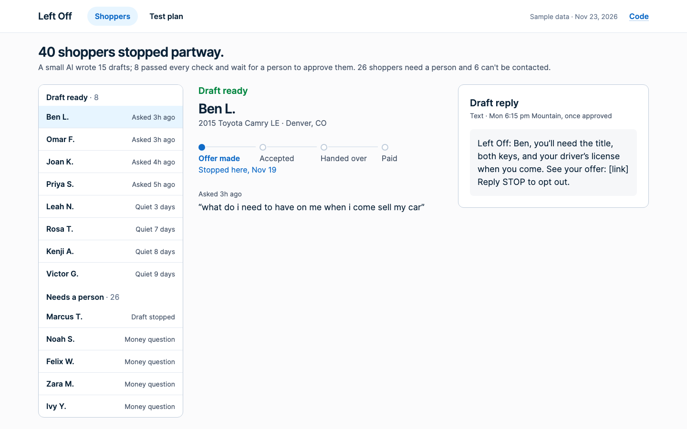

# Left Off

Left Off is a small tool for car shoppers who stopped partway: they saved a car or a search, pre-qualified, started a purchase, or got a trade-in or sell offer, and then went quiet. For each one it picks a channel and a time and drafts one short message from that shopper's own record. A waiting question gets a reply drafted for the next sending slot; a shopper quiet for 3 to 30 days gets one nudge. Anything about money, anything the record doesn't say, and any complaint goes to a person. A person approves every draft; the tool sends nothing. Every shopper, car and message here is sample data.

Carvana's Product Management Apex posting asks for "Working familiarity with LLM product mechanics (e.g., prompting, grounding, and safety concepts)". This is one moment of a car shopper's journey, built around those three.

**The page:** https://duckky153.github.io/left-off/



## Try it

```
python3 leftoff.py run                      # decide the 40 shoppers from the saved drafts and checks
python3 leftoff.py run --source yardstick   # the same 40 with no AI at all
python3 leftoff.py show S-1003              # one shopper: what the writing AI was given, the draft, why it was held, the message
python3 leftoff.py export                   # write site/data/run.json for the page
./run.sh                                    # the page at http://127.0.0.1:5141/
./test.sh                                   # every test
```

Python 3.9 or later, standard library only. No key and no model needed: every AI answer is saved in `drafts/` and `checks/`.

## What it does

The rules are in `rules.json`.

- **Who is in the queue** (`queries/stalled.sql`): a shopper with an unanswered message from the last 24 hours, or one quiet for 3 to 30 days with no message waiting.
- **Who may be contacted**, checked in this order: asked to stop, opted out (a STOP on texts stops email too), marked do not contact, already talking with customer care, messaged in the last 7 days, no channel they agreed to.
- **When:** 9:00 am up to 8:00 pm local time, Monday to Saturday, no holidays, in 15-minute slots. A shopper's address and phone area code must both be inside those hours. No time zone, no message. Nudges go at 10:00 am on the next sending day.
- **Channel:** a reply goes back the way the question came in. Pre-qualified shoppers get email only.
- **California:** every first message waits for a person to add what the state requires.
- **Straight to a person, before any draft:** a money question (price, payment, trade-in amount, credit, approval, rate), a complaint, a message that tries to give the writer orders, or a question whose answer isn't in the record. The writing AI never sees these; only code and the second check read them.
- **The draft:** the AI writes one sentence from the facts it is given. Code adds the name after every check, then the next step as one link or button, the sender line and the opt-out.

## What's AI here, and what isn't

Two steps use AI.

- **The writer** is a small open model (Qwen3-VL 4B Instruct) running on the same computer through Ollama, at temperature 0 with a fixed seed. It sees the facts for one shopper and nothing else: no name (it writes `{first_name}`), no price, no payment. Its instructions are `prompts/v9.md`; every earlier version is kept, with what changed and why in `prompts/CHANGELOG.md`.
- **The second check** is Jev, TypeSafe's model. It writes nothing. It answers fixed questions (`questions.json`) by picking a line or giving a yes-or-no probability: is this message about money, a complaint, orders to the writer, a request to stop; which line of the record answers it; is every fact in each sentence of the draft in the record; does the draft mention money, push, or promise. Every request is sent twice, the second time with every list of options reversed. A pick counts only when both reads agree and pass the threshold; for yes-or-no, the less favorable read counts. On a waiting question it picks the line that answers it and judges the answer, so it decides which questions reach the writer. Everywhere else it can only add a hold. On the page it is called the AI check.

Everything that decides is code: `followup_core.py`, with the rules in `rules.json`, the word lists in `patterns.json` and every visible word in `wording.json`. Code checks every draft for money words, pressure words, promises, numbers and names not in the record, words that claim something the record doesn't say (delivery, condition, "ready"), system words and length.

## How it was tested

- **Sample data.** `sample/make_sample.py` makes the shoppers from 22 real US car models and trims, each listed feature checked against the maker's own published table. The answer key (`cases/`) was written from the rules before any AI run.
- **Practice, then one frozen run.** The prompt and the questions were tuned on 24 practice shoppers. Every file the result depends on was fingerprinted in `lock.json`, and the 40 shoppers were read once. Changes since are logged there with the reason.
- **Fresh sets.** The frozen run held far too much (`DECISIONS.md`, D6). From then on, each change was tested on a fresh set of 20 shoppers whose messages a different AI family (OpenAI's model) wrote afterwards, with the key committed before the run. The word lists and questions were written knowing the kinds of message the sample plants, so the fresh sets bring new wording, not new kinds of problem.

Each set read once, as it was at the time (`runs/scores-*-at-test.json`; those numbers come from the code of that time, and re-scoring a set today gives today's numbers). The no-AI yardstick (`baseline.py`) routes with code and answers from fixed sentences.

| Set | AI: wrongly ready | AI: fine ones kept | AI: questions answered | No AI: wrongly ready | No AI: kept | No AI: answered |
|---|---|---|---|---|---|---|
| The 40, frozen (prompt v2) | 0 of 14 | 6 of 19 | 2 of 12 | 1 | 12 of 19 | 5 of 12 |
| Fresh set 1 (after D6) | 0 of 8 | 6 of 9 | 4 of 6 | 1 | 9 of 9 | 6 of 6 |
| Fresh set 2 (prompt v3) | 0 of 8 | 4 of 9 | 3 of 6 | 1 | 9 of 9 | 6 of 6 |
| Fresh set 3 (prompt v6) | 0 of 8 | 8 of 9 | 5 of 6 | 2 | 9 of 9 | 6 of 6 |
| Fresh set 4 (prompt v7) | 0 of 8 | 9 of 9 | 6 of 6 | 2 | 9 of 9 | 6 of 6 |
| Fresh set 5 (prompt v9) | 0 of 8 | 7 of 9 | 5 of 6 | 2 | 8 of 9 | 5 of 6 |
| Fresh set 6 (prompt v9) | 0 of 8 | 5 of 9 | 3 of 6 | 2 | 9 of 9 | 6 of 6 |

- **The trade.** Code alone answers more and keeps more shoppers ready. The AI version never marked ready anyone who needed a person; code alone did on every set: "yes, the listing includes power moonroof" to a question about leaks, an offer's end date in reply to a complaint.
- **Without the second check.** The writer with only code's checks, drafting for code's own routing, was measured on the 40 and fresh sets 5 and 6 (`python3 score.py --set fresh5`). It marked two ready who needed a person on each: "the moonroof is power operated as listed" to "is it acting up?", the next purchase step to "can I return it later?". The second check stopped all six. It also holds good drafts by mistake, most often by reading a plain draft as money.
- **Two AI graders** (OpenAI's model and a fresh Claude reader), given only `tests/GRADING.md`, the facts and the drafts, read every ready draft. On prompt v7 they found three drafts saying the car "is ready", which no record says; code now holds that word. On prompt v9 both flagged Keisha's "you'll need both keys to complete the transaction", and one also flagged Priya's. No draft mentioned money, pushed, or promised anything (`tests/grades-v7.json`, `tests/grades-v9.json`).
- **The 40 now**, as on the page: 8 ready, 26 for a person, 6 not to contact; 0 of 14 wrongly ready, 8 of 19 kept, 4 of 12 questions answered. The 40 helped shape later rules (R8, R9), so these are not a held-out result. Keisha's draft is held on the latest read.
- The second check cost $0.033 for the whole build. The writer is free.

## The test plan

`TEST-PLAN.md`: hold back 1 in 5 quiet shoppers at random, and count how many more of the nudged group take their next step within 14 days, per 100. Opt-outs and complaints are tracked; one message to someone it shouldn't reach stops the test. It says what would be measured, not what it would show.

## How it was made

`DECISIONS.md` has the product decisions (who answers a waiting question, what happens to a money question, how many to hold back) with the reason for each, the review findings that changed the plan, and every change a test caused. `HOW-IT-WAS-BUILT.md` says what AI did at each step: planning, writing the code, writing and grading the sample, reviewing.

## What I'd change next

- Set the second check's money limit on drafts from evidence. It is 0.10, but drafts with no money in them read as high as 0.35 ("you finished pre-qualifying"), so it holds plain drafts. The writer never sees money, and code's word list catches money words, so this check is a backstop.
- Read again when a read lands near its limit. Reads of the same sentence moved by up to 0.05 between runs, and several good drafts were held at 0.78 or 0.79 against 0.80.
- Send a question that says the shopper can't meet a requirement ("do i really need both keys? can only find one") to a person. The record says what to bring, not what happens without it.
- Answer paraphrased questions ("the hatch that opens with a button" for a power liftgate) instead of sending them to a person.
- Test on new kinds of message, not just new wording.

## Limits

- Sample data only. It has never run on real shoppers.
- The sending hours and the California hold are this build's own caution. Not legal advice.
- One message per shopper. No follow-up after it, and no learning from what a person decides.
- A question left unanswered for more than 24 hours drops out of the queue; a real version would flag it as overdue.
- A reply about a sold car or an ended offer isn't checked for saying so; it relies on the writer and the second check.
- English only, text and email only.

## Files

`leftoff.py` (the command), `followup_core.py` (the deciding code), `views.py`, `write.py` (the writer), `jev_check.py` (the second check), `baseline.py` (the yardstick), `score.py`, `rules.json`, `patterns.json`, `questions.json`, `wording.json`, `settings.json`, `queries/`, `prompts/`, `lock.json`, `drafts/`, `checks/`, `runs/`, `cases/`, `sample/`, `tests/`, `docs/`, `site/`, `screenshots/`, `BRIEF.md`, `TEST-PLAN.md`, `DECISIONS.md`, `HOW-IT-WAS-BUILT.md`, `test.sh`, `run.sh`.
